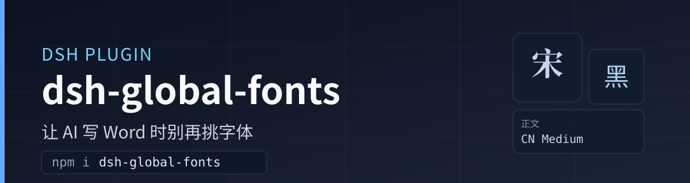

# dsh-global-fonts



**让 AI 写 Word / PPT 时别再挑字体。**

把本机字体表钉进 DeepSeek Harness 的系统提示词。模型直接照抄，不查、不比、不问、不解释。

[](https://www.npmjs.com/package/dsh-global-fonts)
[](https://www.npmjs.com/package/dsh-global-fonts)
[](./LICENSE)

> Pins a fixed font table into the DSH system prompt so the model stops re-detecting, comparing,
> or asking about fonts. A settings panel remaps every role for CJK and Latin text.
> Windows + Office. Source Han fonts optional — missing ones are substituted silently.

---

## 没有它 vs 有它

| | 实际发生什么 |
| --- | --- |
| **没有它** | 模型先查一遍已装字体 → 比较黑体还是宋体 → 反问你「用哪个」 → 写个近似名「思源黑体 Medium」 → Word 静默替换成别的字体，你还看不出来 |
| **有它** | 直接照表套 `思源黑体 CN Medium`，一次到位 |

差别就在提示词里那张表。模型不再把 token 花在挑字体上。

## 安装

**插件市场**：设置 → 插件 → 搜 `dsh-global-fonts`。

**命令行**：

```bash
dsh plugin --profile <你的 profile> add dsh-global-fonts
```

装完重启一次 DSH，然后去 **设置 → 字体**。

## 默认字体表

| 用途 | 中文 | 西文 |
| --- | --- | --- |
| 标题 | `思源宋体 CN Heavy` | `思源黑体 CN Heavy` |
| 小标题 | `思源黑体 CN Bold` | `思源黑体 CN Bold` |
| 正文 | `思源黑体 CN Medium` | `思源黑体 CN Medium` |
| 加粗 | `思源黑体 CN Bold` | `思源黑体 CN Bold` |
| 图表注 | `思源黑体 CN Regular` | `思源黑体 CN Regular` |

正文一律黑体，宋体只给标题。表里写的是 **GDI 家族名（face 名）**，不是家族简称 ——
差一个词，Word 就会静默换字体。

## 面板

**设置 → 字体**。

```
┌──────────────────────────────────────────────┐
│ 启用字体注入                           [开]  │
├──────────────────────────────────────────────┤
│              中文              西文          │
│ 标题    思源宋体 CN Heavy    思源黑体 CN…   │
│ 小标题  思源黑体 CN Bold     思源黑体 CN…   │
│ 正文    思源黑体 CN Medium   思源黑体 CN…   │
│ 加粗    思源黑体 CN Bold     思源黑体 CN…   │
│ 图表注  思源黑体 CN Regular  思源黑体 CN…   │
├──────────────────────────────────────────────┤
│ 恢复默认   重读字体   看注入的提示词          │
└──────────────────────────────────────────────┘
```

- **总开关** —— 关掉立刻停止注入，模型回到自己挑字体
- **字体表** —— 每个格子一个可搜索下拉，候选是本机所有已装字体
- **恢复默认** / **重读字体** / **看注入的提示词**

选中一个字重时，如果它需要额外的 `bold=true` 才对（思源宋体 400/700 共用一个家族名
就是这么坑），面板会自动帮你带上。改完自动保存，**下一句话就生效，不用重启**。

## 没装思源字体怎么办

**不装也能用。** 三层兜底：

1. **面板红字** —— 缺哪几个，直接列在字体表下面
2. **提示词静默替换** —— 检测到缺失时，注入的表后面会多一段：遇到这些名字，改用本机已有的同类字体（中文优先 微软雅黑 → 宋体 → 等线；西文优先 Arial → Calibri），不写缺的名字，也不跟用户解释
3. **面板手动改** —— 换成你已装的字体，或者干脆改成微软雅黑 / 宋体

想彻底对齐就装一套思源，免费开源：

- 思源黑体：https://github.com/adobe-fonts/source-han-sans/releases
- 思源宋体：https://github.com/adobe-fonts/source-han-serif/releases

装完在面板点「重读字体」。

## 谁适合用

- 用 DSH 写 Word / PPT / Excel
- 在意中文字体名，被 Word 静默替换坑过
- 手上装了不止一套中文字体，想让 AI 稳定用其中一套
- Windows

## 字体候选从哪来

按顺序找，前一个没有就用后一个：

1. **office-fonts skill 的索引** —— `$DSH_HOME/skills/office-fonts/cache/fonts.json`，
   带完整字重信息（哪个是 Medium、哪个是 Heavy、哪个要 bold），最准
2. **Windows GDI 扫描** —— PowerShell 跑 `System.Drawing.Text.InstalledFontCollection`，
   缓存到 `~/.dsh/global-fonts/fonts-cache.json`。只有名字，没有字重区分
3. 都没有 —— 面板输入框直接手打字体名，照样能用

装了 office-fonts skill 就优先用它；没装也能跑。

## 手动安装 / 本地开发

```bash
# profile 目录，形如 ~/.dsh/profiles/desktop
# 1. package.json 的 dependencies 加
#      "dsh-global-fonts": "file:/path/to/dsh-global-fonts"
#    dsh.profile.bundles 加
#      "dsh-global-fonts"
# 2. 建软链。不想让包管理器动 store 的话，直接 junction 最省事
#      node_modules/dsh-global-fonts -> /path/to/dsh-global-fonts
# 3. 重启 DSH
```

改 `index.js` / `client.js` 要重启；面板里改字体值不用。

自检：

```bash
node self-test.mjs
```

## 配置

| 变量 | 作用 |
| --- | --- |
| `DSH_GLOBAL_FONTS=off` | 整体停用，不注入任何提示词 |
| `DSH_GLOBAL_FONTS_HOME` | 数据目录，默认 `~/.dsh/global-fonts` |
| `DSH_FONT_CACHE` | 指定 office-fonts 索引的绝对路径 |

数据文件：

```
~/.dsh/global-fonts/state.json         开关 + 五个用途 × 中/西文
~/.dsh/global-fonts/last-prompt.txt    最近一次注入的原文（排障用）
~/.dsh/global-fonts/fonts-cache.json   GDI 扫描缓存
```

## 安全

- HTTP API 只接受回环地址
- 走 DSH 自己的 Host / Origin / 浏览器认证准入（`ctx.connection.requestRejection`），
  浏览器里任意网页都调不动它

## 已知限制

- **只在 Windows 上有意义**：字体名是 GDI 家族名，写的是 Office 的 `eastAsia` / `ascii` 槽
- 系统扫描拿不到字重，同一个家族的不同字重会显示成多个并列名字
- 不装思源字体不会报错，会走上面的静默替换

## 许可

MIT